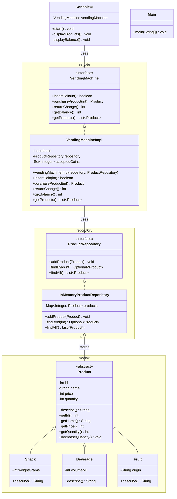

# Vending Machine — Class Diagram

> `Main` is intentionally isolated. It is an **entry point only**: it instantiates `VendingMachineImpl` and `ConsoleUI`, wires them together, and calls `start()`.

